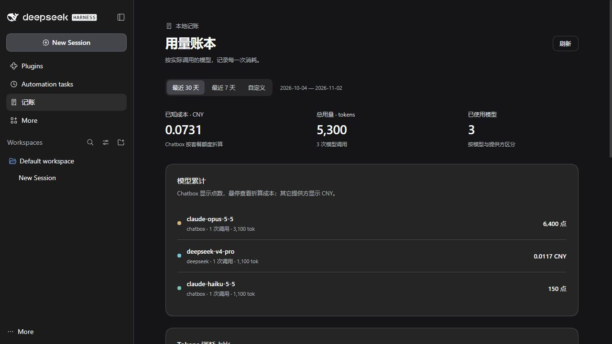

# DSH 计费与用量账本

为 DeepSeek Harness 增加当前输出计费和本地用量统计。Chatbox 显示点数，其它提供方按已配置费率显示人民币；在原生暗色界面中查看模型累计消耗和占比。

**当前版本：0.1.6 · Windows · DSH 0.2.1-rc.3 / 0.2.1-rc.5 · MIT**

这是一个独立的 Cordis 插件，使用 DSH 插件加载机制。运行于 DSH 内部，不额外启动常驻服务，也不为统计用量额外调用模型。

## 功能

- 回复底部显示 `用量　计费 2,944 点　28.7K tok`。点击原有“用量”按钮，在浮窗中查看计费行。
- 回复区只显示当前输出对应调用的费用。标题、压缩、重试等其它调用进入账本。
- 左侧“记账”入口位于“自动化任务”和“更多”之间。
- 最近 30 天、7 天或自定义范围，最长 6 个自然月，按北京时间自然日统计。
- 只列出使用过的模型；Chatbox 累计点数悬停显示折算 CNY。
- tokens 占比与统一 CNY 占比饼图上下排列，首次滚动可见时展开，并尊重系统减少动态效果设置。
- 持久保存计费快照，历史回放和分叉继承不会重复累计。缺少用量或费率时显示待计价。

下图使用三条虚构账目演示界面：



## 安装：下载现成 Windows 发布包

1. 安装并启动过受支持版本的 DSH。
2. 前往 [Releases](https://github.com/caihe-haku/dsh-billing-ledger/releases)，下载 `dsh-billing-ledger-0.1.6-windows.zip` 并完整解压。页面上的 **Source code** 是源码，不是这个安装包。
3. 在解压目录打开 PowerShell，执行：

   ```powershell
   powershell -NoProfile -ExecutionPolicy Bypass -File .\install.ps1
   ```

4. 正常退出并重新打开 DSH，查看左侧“记账”和回复下方的计费。

支持 Windows PowerShell 5.1 或 PowerShell 7。安装现成发布包无需自行安装 Node.js、npm 或编译工具；脚本调用 DSH 自带的 CLI。上述执行策略参数仅作用于这次 PowerShell 进程。

脚本尝试从正在运行的 DSH、桌面／开始菜单快捷方式或 PATH 寻找 CLI。若找不到，指定实际路径，例如：

```powershell
powershell -NoProfile -ExecutionPolicy Bypass -File .\install.ps1 -DshCli "D:\Apps\DeepSeek Harness\resources\runtime\cli\bin\dsh.cmd"
```

自定义用户目录可加 `-DshHome "D:\DSH-Data"`，自定义 profile 可加 `-Profile 名称`。默认使用 `DSH_HOME`，未设置时使用 `%USERPROFILE%\.dsh`；请确保与启动 DSH 时的用户目录一致。

安装前会校验包哈希和 DSH 版本，并备份 profile。安装包会复制到 DSH 用户目录下的 `plugin-packages/dsh-billing-ledger/`，以后不依赖下载目录。可先加 `-WhatIf` 检查路径与版本，不执行安装。

## 费用与适用范围

当前保留作者自用的固定换算基准：**每百万 Chatbox 点数 = 9.375 CNY**。这是套餐额度分摊成本，不是点数消耗时额外扣款，也不代表所有用户的套餐成本。本版没有新增换算设置界面；自定义记账模块留待后续开发。

内置六个 Chatbox 模型的历史校准费率，以及部分 DeepSeek 直连和百炼北京模型的 CNY 费率。完整说明见 [费率与精度](https://github.com/caihe-haku/dsh-billing-ledger/blob/main/docs/rates.md)。

所有金额均为按已知用量和费率计算的**估算值**。提供方名称和模型需准确匹配；GLM、MiMo、其它地域、未配置模型或中转折扣没有经过验证时保留待计价。推理 tokens 已包含在输出中，不重复加算。回复底部的 token 数可能是整轮合计，新增计费值仅对应当前输出。

## 数据保存

默认账本：`%USERPROFILE%\.dsh\storages\billing-ledger\ledger-v1.jsonl`；设置 `DSH_HOME` 后改用相应目录。记录仅包含请求身份、路由、时间、用量和费用，不复制聊天正文、API 密钥或 replay state，也不将账目发送到外部统计服务。

安装或升级保留旧账。已有费用快照不按新费率重算；未知值不会伪装成零。安装前没有保存响应 usage 的辅助调用，无法补造其费用。第三方工具绕过 DSH 且不返回 usage 的请求不在可统计范围。

profile 备份位于 DSH 用户目录的 `backups/billing-ledger/`，可能包含个人配置，请自行妥善保存。

## 兼容性与更新

本版仅声明支持 **0.2.1-rc.3、0.2.1-rc.5**。DSH 更新后可能因版本不匹配而跳过加载；请安装已验证的新插件版本。账本独立保存，入口暂时消失不代表账目被清空。

回复费用通过官方 `conversation.chat.turnTail` 插槽挂载，局部适配原使用量按钮及浮窗。DSH 升级时需要同时复核插件接口和原生控件结构。

## 卸载

在发布包解压目录执行：

```powershell
powershell -NoProfile -ExecutionPolicy Bypass -File .\uninstall.ps1
```

需要时同样添加 `-DshCli`、`-DshHome` 或 `-Profile`。完成后重开 DSH。卸载保留聊天、账本、备份及安装包缓存。

## 开发与打包

开发需要 Node.js 24、npm、PowerShell 7。核心计算和前端构建没有额外 npm 依赖；宿主的 peer 由 DSH 运行环境提供。

```powershell
npm test
npm run check
npm run build
npm run release
```

发布产物位于 `dist/`：Windows 安装 ZIP、独立 `.tgz` 和 `SHA256SUMS.txt`。仓库测试使用虚构用量，不包含私人账单、截图或配置备份。

本次发布的检查范围见 [验证记录](https://github.com/caihe-haku/dsh-billing-ledger/blob/main/docs/validation.md)。

问题反馈请通过 [Issues](https://github.com/caihe-haku/dsh-billing-ledger/issues)，附 DSH／插件版本及错误现象；分享日志前请自行去除凭据和个人会话内容。

## 许可

[MIT License](LICENSE) · Copyright © 2026 caihe-haku
